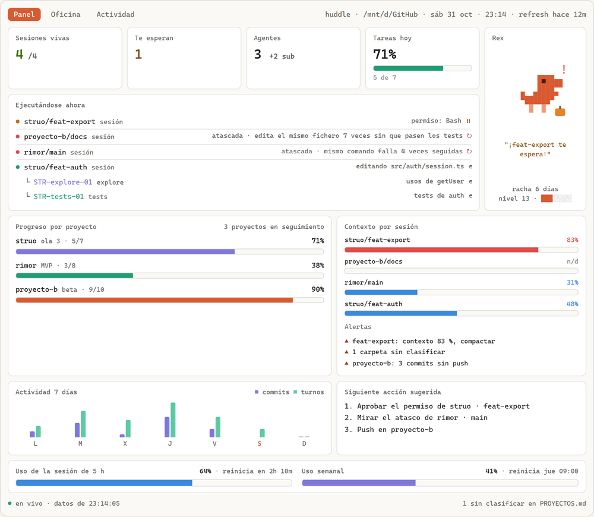
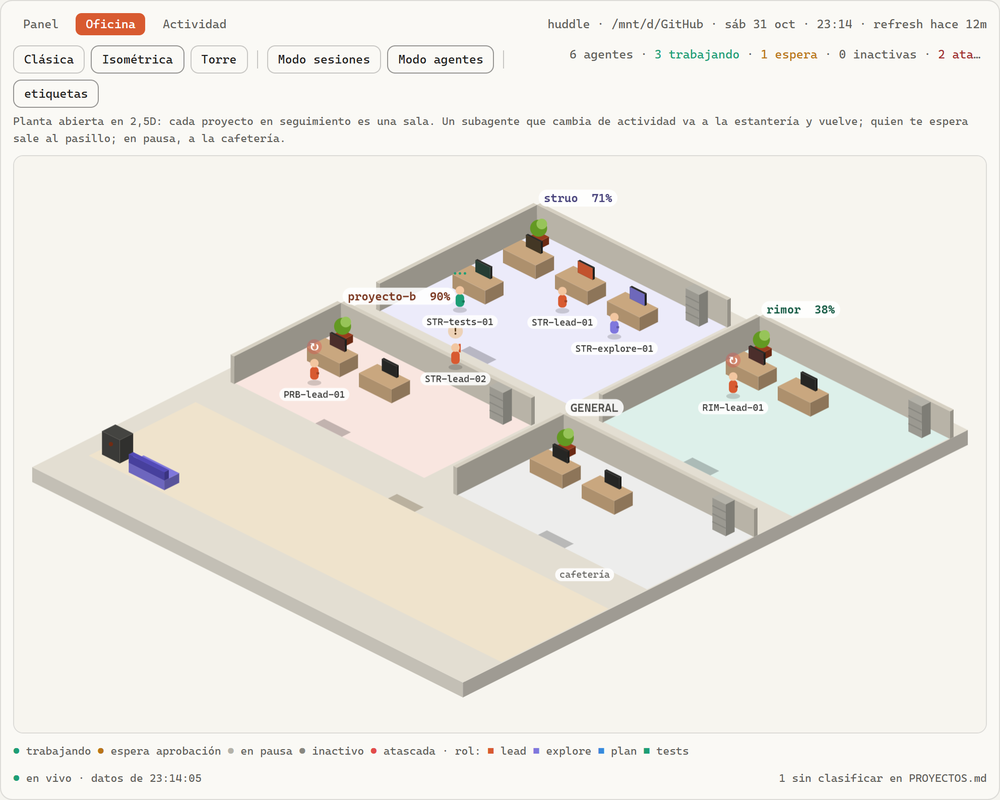
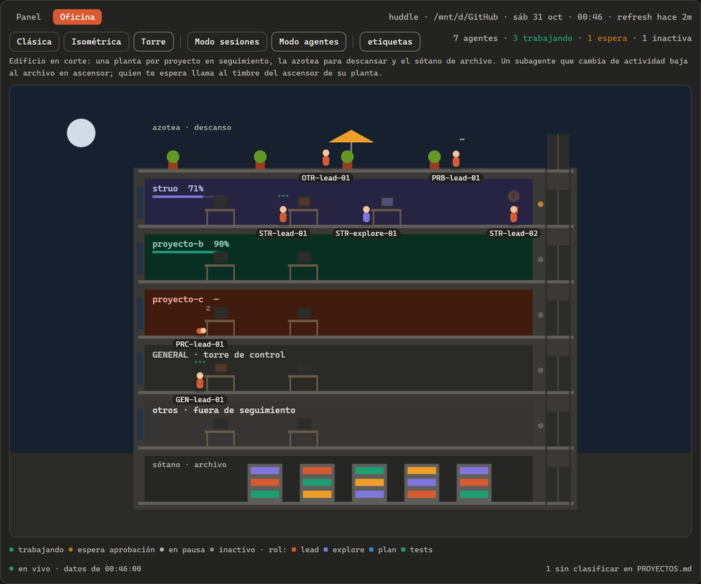
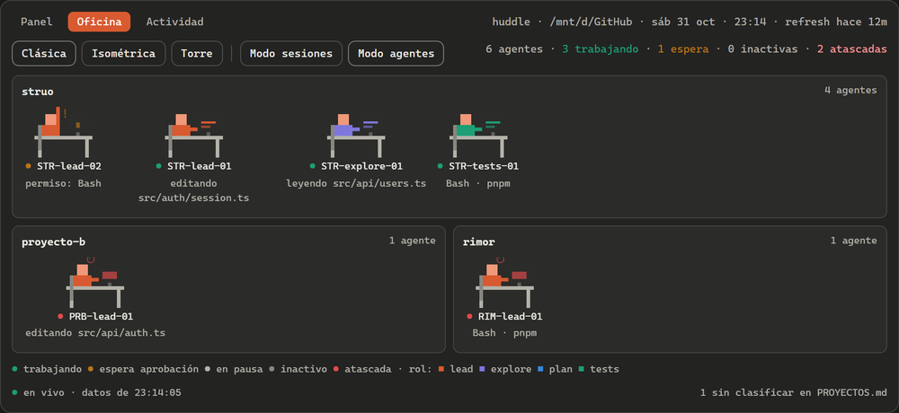
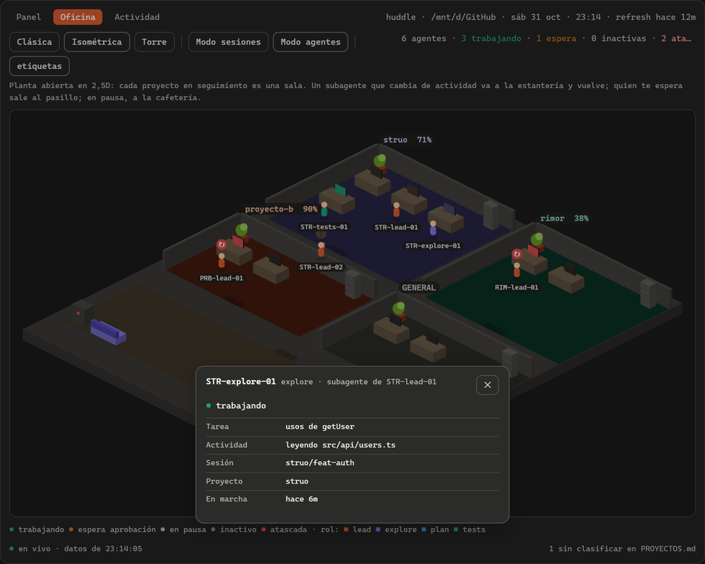
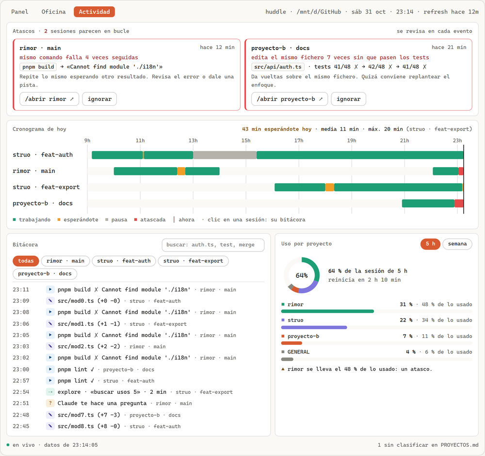
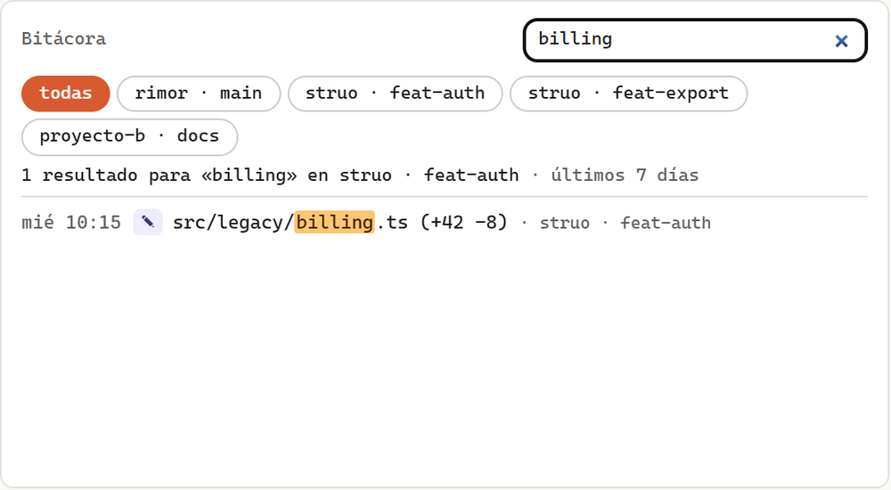

# Huddle

**Tu equipo de Claude Code, de un vistazo: proyectos, sesiones y agentes en un solo panel.**

Huddle es un mod de Claude Code para organizar tus proyectos de un vistazo. Abres una sesión en una carpeta de control y ves todas tus sesiones, agentes y proyectos: quién está trabajando, quién te espera, cómo va cada proyecto, cuánto contexto ha usado cada sesión y cuánto uso te queda. Todo el estado se guarda en Markdown sencillo, editable a mano.

```
p:  Panel  o:  Oficina   huddle · /mnt/d/GitHub    sáb 31 oct · 03:46 · refresh hace 2m
╭─ Sesiones ────────╮ ╭─ Te esperan ──────╮ ╭─ Agentes ─────────╮ ╭─ Tareas hoy ──────╮
│ █ █               │ │ ▄█                │ │ ▀▀█               │ │ ▀▀█ ▄█            │
│ ▀▀█               │ │  █                │ │ █▀▀               │ │  ▄▀  █            │
│   ▀ /5            │ │ ▀▀▀               │ │ ▀▀▀ +2 sub        │ │  ▀  ▀▀▀ %         │
│ 2 trab · 1 pausa  │ │ feat-export · 9m  │ │ explore · tests   │ │ ███████▊    5/7   │
╰───────────────────╯ ╰───────────────────╯ ╰───────────────────╯ ╰───────────────────╯
╭─ Rex ─────────── alerta ─╮ ╭─ Ejecutándose ahora ────────────────────── 5 sesiones ─╮
│           ▀▀▀▀▄▄         │ │ ● struo · feat-export  sesión   permiso: Write       ⏸ │
│           ▀▀▀▀▀▀ !       │ │ ● struo · feat-auth    sesión   editando auth.ts     ◓ │
│       ▀▄▄▀▀▀▀▀▀          │ │ └ STR-explore-01       explore  usos de token        ◑ │
│        ▀▀▀▀▀▀    ▄       │ │ └ STR-tests-01         tests    vitest 212/240       ◑ │
│         ▀  ▀    ▀▀▀      │ │ ● proyecto-b · main    sesión   migración v2         ◓ │
│     “¡feat-export te     │ │ ● GENERAL · torre      sesión   sesión abierta       · │
│         espera!”         │ │ ● proyecto-c · main    sesión   inactiva 3h 1m       z │
│  racha 7 días · nivel 1  │ │                                                        │
╰──────────────────────────╯ ╰────────────────────────────────────────────────────────╯
╭─ Progreso por proyecto ──────── 3 de 4 ─╮ ╭─ Contexto por sesión ───────────────────╮
│ struo      ola 3 · 5/7 ███████▊     71% │ │ struo·feat-export       ████████▎   83% │
│ proyecto-b migración … █████████▉   90% │ │ struo·feat-auth         ████▊       48% │
│ proyecto-c MVP · 4/10  ████▍        40% │ │ proyecto-b·main         ███▏        31% │
│                                         │ │ GENERAL·torre                       n/d │
│                                         │ ╰─────────────────────────────────────────╯
│                                         │ ╭─ Alertas ─────────────────────────── 4 ─╮
│                                         │ │ ▲ feat-export: contexto 83 %, compactar │
│                                         │ │ ▲ feat-export: espera hace 9 min        │
│                                         │ │ ▲ proyecto-b: 3 commits sin push        │
│                                         │ │ ▲ 1 carpeta sin clasificar              │
╰─────────────────────────────────────────╯ ╰─────────────────────────────────────────╯
╭─ Actividad ──────── ■ commits ■ turnos ─╮ ╭─ Siguiente acción ──────────────────────╮
│              ██                         │ │ 1. Aprobar GATE#1 en struo/feat-export  │
│    ▇█        ██    ▃                    │ │ 2. Compactar esa sesión                 │
│    ██    █   ██   ▆█        ▁▅          │ │ 3. Push en proyecto-b                   │
│    ██   ▅█   ██   ██   ▁█   ██   ▁▁     │ │                                         │
│     L    M    X    J    V    S    D     │ │                                         │
╰─────────────────────────────────────────╯ ╰─────────────────────────────────────────╯
╭─ Sesión 5 h ────────────────────────────╮ ╭─ Semana ────────────────────────────────╮
│ ██████████▉                         31% │ │ ███████████▉                        34% │
│ reinicia en 1h 41m                      │ │ reinicia vie 07:00                      │
╰─────────────────────────────────────────╯ ╰─────────────────────────────────────────╯
 /oficina · /refresh · /preguntar · /abrir                            1 sin clasificar
```

*El panel acoplado a la derecha de la conversación, a 87 columnas (captura real con datos de ejemplo; en el terminal las tarjetas, las barras y Rex van en color).*

```
p:  Panel  o:  Oficina  s:  Sesiones  a:  Agentes  oficina 5 sesiones · 2 trabajando ·…
╭─ struo ───────────────────────────────────────────────────────────────── 4 agentes ─╮
│     ▀▀ ▀! ▄▄▄▄▄         ▀▀    ▄▄▄▄▄         ▀▀    ▄▄▄▄▄         ▀▀    ▄▄▄▄▄         │
│    ▀▀▀▀▀  ▀▀▀▀▀        ▀▀▀▀   ▀▀▀▀▀        ▀▀▀▀   ▀▀▀▀▀        ▀▀▀▀   ▀▀▀▀▀         │
│    ▀▀▀▀ ▄▄▀▀▀▀▀        ▀▀▀▀▀▀▄▀▀▀▀▀        ▀▀▀▀▀▀▄▀▀▀▀▀        ▀▀▀▀▀▀▄▀▀▀▀▀         │
│   ▀▀▀▀▀▀▀▀▀▀▀▀▀▀      ▀▀▀▀▀▀▀▀▀▀▀▀▀▀      ▀▀▀▀▀▀▀▀▀▀▀▀▀▀      ▀▀▀▀▀▀▀▀▀▀▀▀▀▀        │
│    ▀          ▀        ▀          ▀        ▀          ▀        ▀          ▀         │
│ ● STR-lead-02       ● STR-lead-01       ● STR-explore-01    ● STR-tests-01          │
│   permiso: Write      editando auth.ts    Bash · rg           Bash · pnpm           │
╰─────────────────────────────────────────────────────────────────────────────────────╯
╭─ proyecto-b ─────────────────── 1 agente ─╮ ╭─ GENERAL ────────────────── 1 agente ─╮
│        ▀▀    ▄▄▄▄▄                        │ │              ▄▄▄▄▄                    │
│       ▀▀▀▀   ▀▀▀▀▀                        │ │       ▄▄▄ z  ▀▀▀▀▀                    │
│       ▀▀▀▀▀▀▄▀▀▀▀▀                        │ │       ▀▀▀▀▀▄▄▀▀▀▀▀                    │
│      ▀▀▀▀▀▀▀▀▀▀▀▀▀▀                       │ │      ▀▀▀▀▀▀▀▀▀▀▀▀▀▀                   │
│       ▀          ▀                        │ │       ▀          ▀                    │
│ ● PRB-lead-01                             │ │ ● GEN-lead-01                         │
│   migración v2                            │ │   sesión abierta                      │
╰───────────────────────────────────────────╯ ╰───────────────────────────────────────╯
╭─ proyecto-c ───────────────────────────────────────────────────────────── 1 agente ─╮
│              ▄▄▄▄▄                                                                  │
│       ▄▄▄ z  ▀▀▀▀▀                                                                  │
│       ▀▀▀▀▀▄▄▀▀▀▀▀                                                                  │
│      ▀▀▀▀▀▀▀▀▀▀▀▀▀▀                                                                 │
│       ▀          ▀                                                                  │
│ ● PRC-lead-01                                                                       │
│   inactiva 3h 2m                                                                    │
╰─────────────────────────────────────────────────────────────────────────────────────╯
 Estados ● trabajando  ● espera  ● pausa  ● inactiva  · Roles ■ lead  ■ explore  ■ pla…
 /panel · /oficina sesiones
```

*La oficina en modo agentes.*

## Qué incluye

- **Panel**: sesiones vivas, sesiones que te esperan, agentes y subagentes en ejecución, progreso por proyecto, contexto por sesión, alertas, actividad de los últimos 7 días, siguiente acción sugerida y uso del periodo de 5 h y de la semana.
- **Oficina**: tus sesiones o tus agentes como empleados en sus mesas, agrupados por proyecto.
- **Un compañero en el panel**: Rex, un pequeño dinosaurio de píxeles que duerme, trabaja, se pone en alerta o celebra según el estado real de tus sesiones. Se disfraza el 31 de octubre y en diciembre.
- **Carpeta de control en Markdown**: `ESTADO.md`, una ficha por proyecto y un diario mensual. Sin base de datos.
- **Avisos de escritorio** cuando una sesión necesita tu aprobación, también en Windows desde WSL.
- **Consultas a otras sesiones** con `/preguntar`, en modo solo lectura, y **fichas rellenadas por Claude** con `/fichas`.
- **Vista web en vivo** con `/huddle web`: el Panel, la Oficina (clásica, isométrica o en torre) y la pestaña **Actividad**, con las sesiones atascadas, el cronograma del día, la bitácora de cada sesión con buscador y el uso por proyecto.

## Requisitos

- Claude Code **2.1.314 o posterior** (mods con hooks de función), en la terminal. En la pestaña Code de la app de escritorio el panel se dibuja, pero sin git, avisos ni `/abrir`, porque allí los mods no pueden lanzar procesos.
- git.
- Linux, macOS o Windows con WSL.
- Opcional: [`gh`](https://cli.github.com/), para ver el estado del CI en las alertas.

## Instalación

1. Instala el mod a nivel de usuario, para que funcione en todas tus sesiones. En el prompt de Claude Code:
   ```
   /plugin install huddle --marketplace <tu-usuario>/huddle
   ```
   Responde `y` para añadir el marketplace y elige el ámbito **usuario**. Desde la shell, lo mismo es `claude plugin install huddle --marketplace <tu-usuario>/huddle`.
2. Crea tu carpeta de control y abre Claude Code en ella:
   ```bash
   mkdir -p /mnt/d/GitHub/GENERAL && cd /mnt/d/GitHub/GENERAL && claude
   ```
3. Ejecuta `/configurar` e indica dónde viven tus proyectos (por ejemplo `/mnt/d/GitHub`). También puedes darlo directamente: `/configurar /mnt/d/GitHub`.
4. Abre `PROYECTOS.md` y mueve cada carpeta a **Hacer seguimiento** o **No hacer seguimiento**. Luego ejecuta `/proyectos` para crear las fichas.

Listo. A partir de ahora, cada vez que abras Claude Code en esa carpeta verás el panel.

Una guía corta de todo esto, paso a paso: [`docs/primeros-pasos.md`](docs/primeros-pasos.md).

> **El panel sale solo** a partir de 144 columnas. En un terminal más estrecho, ábrelo con `/panel`. Con la pantalla completa de Claude Code se acopla a la derecha de la conversación (hasta el 45 % del ancho); sin ella, aparece encima del prompt, a todo el ancho.

## Dónde se activa

Huddle se instala a nivel de usuario porque necesita **estar en todas tus sesiones para verlas**: cada una anota su estado y el panel lo lee. Aun así, fuera de la carpeta de control es invisible. No dibuja nada ni añade ningún comando al autocompletado (solo `/configurar` mientras no esté configurado); solo escribe un JSON pequeño con su estado. Las sesiones `claude -p` y del SDK no cuentan.

| Quieres… | Cómo |
|---|---|
| Que Huddle vea todas tus sesiones (lo normal) | `claude plugin install huddle --marketplace <tu-usuario>/huddle --scope user` |
| Que una carpeta no aparezca nunca en el panel | Desde esa carpeta: `claude plugin disable huddle --scope local` (vuelve con `enable`) |
| Que otro mod solo exista en su carpeta | Instálalo desde esa carpeta con `--scope local` (solo para ti) o `--scope project` (queda en el `.claude/settings.json` del repo) |
| Probar Huddle en una sola sesión, sin instalarlo | `claude --plugin-dir /ruta/a/huddle` |

Si instalas Huddle solo en la carpeta de control, el panel funcionará (`/refresh`, fichas, uso…), pero no verá las demás sesiones ni sus agentes.

## Uso diario

```
cd /mnt/d/GitHub/GENERAL && claude
/refresh
```

| Comando | Para qué |
|---|---|
| `/refresh` | Actualiza git y `ESTADO.md` y te cuenta qué ha pasado desde la última vez. Después Claude redacta el resumen y la siguiente acción (`/refresh solo-datos` lo omite) |
| `/panel` · `/oficina [sesiones\|agentes]` | Cambia entre el panel y la oficina |
| `/huddle web` | Abre la vista web en el navegador; se actualiza sola, sin recargar |
| `/huddle ignorar <id>` | Deja de mostrar un atasco hasta que esa sesión cambie de tarea (lo copia el botón «ignorar» de la web) |
| `/proyecto <nombre> [tests]` | Detalle de un proyecto: ficha, git y sesiones. Con `tests`, Claude ejecuta sus tests sin cambiar nada |
| `/preguntar <proyecto> "<pregunta>"` | Pregunta a la sesión de un proyecto, en solo lectura |
| `/fichas [proyecto]` | Claude rellena lo que falta en las fichas (fase, estado, tareas y próximos pasos), en solo lectura y en segundo plano |
| `/fichas [proyecto] actualizar` | Claude pone las fichas al día: marca como hechas las tareas ya terminadas (y con eso sube el %) y reescribe el estado si lo había escrito él |
| `/abrir <proyecto>` | Abre una pestaña nueva de terminal con Claude Code en ese proyecto |
| `/registro "<texto>"` | Apunta algo en el diario |
| `/cierre` | Resumen del día y próximos pasos; desmarca «Hoy» para mañana y pone al día las fichas de los proyectos que tocaste hoy |
| `/proyectos` | Busca carpetas nuevas en tu directorio de proyectos |
| `/directorio <ruta>` | Cambia el directorio donde viven tus proyectos |
| `/configurar` | Configuración inicial |

Los comandos no llevan prefijo (`/refresh`, no `/huddle:refresh`). Sus respuestas aparecen en la conversación precedidas de `huddle:`.

**Teclas del panel**: `ctrl+x tab` le da el foco (y otra vez, o `Esc`, te lo devuelve). Con el foco, `p` muestra el panel, `o` la oficina, y en la oficina `s` y `a` cambian entre sesiones y agentes.

**Qué significa cada estado**: `trabajando` (verde), `te espera` (ámbar: un permiso o una pregunta), `en pausa` (el turno terminó), `inactiva` (sin actividad desde hace más de `inactiva_min` minutos).

## Vista web

`/huddle web` (en la carpeta de control) crea `.agentos/web/dashboard.html` y lo abre en el navegador: en WSL, en el de Windows, con `explorer.exe`, o con `wslview` si lo tienes; en Linux, con `xdg-open`; en macOS, con `open`. Es un único fichero autocontenido, sin CDN ni peticiones de red, con el Panel, la Oficina y la Actividad como pestañas, y el tema claro u oscuro del sistema.

Se actualiza sola: cada 2 s vuelve a leer `.agentos/web/datos.js` (una línea `window.HUDDLE = {...}`, que escriben tus sesiones en cada evento y `/refresh`) y repinta solo lo que cambió, sin perder la pestaña ni el scroll. Mientras no ejecutes `/huddle web`, las sesiones no escriben nada para la web.

Con `HUDDLE_NO_ABRIR=1`, `/huddle web` solo te da la ruta, sin abrir el navegador.

Así se ve, con datos de prueba (capturas de las pruebas con Playwright, en Edge):

**Panel**: las sesiones vivas y lo que hace cada una (dos de ellas atascadas, en rojo), el progreso por proyecto, el contexto, las alertas, la actividad de la semana, la siguiente acción y el uso de 5 h y semanal. Rex avisa de quién te espera.



**Oficina isométrica**: una sala por proyecto. Quien te espera sale al pasillo con «!», y las sesiones atascadas se ven con «↻» y el monitor en rojo.



**Torre**, en tema oscuro: una planta por proyecto, la azotea para descansar, el sótano de archivo y el ascensor, con su timbre encendido para quien te espera.



**Oficina clásica** y el **detalle** de un subagente, que se abre al hacer clic en un personaje o en el árbol del Panel:





**Actividad**: los atascos, el cronograma de hoy, la bitácora y el uso por proyecto.



**Bitácora**: el buscador encuentra, en los últimos 7 días, un fichero editado hace tres.



**Escenas de la Oficina.** En la web, la Oficina tiene tres escenas, que se eligen en su cabecera, junto a los modos sesiones y agentes:

- **Clásica:** las salas con sus mesas, como en el terminal.
- **Isométrica:** una planta abierta en 2,5D con una sala por proyecto en seguimiento (con su %), GENERAL y, si hace falta, «otros». Cada sala tiene tantas mesas como personajes, y como mínimo 2.
- **Torre:** un edificio en corte, con una planta por proyecto, la azotea arriba, el sótano de archivo abajo y el ascensor a la derecha. Con más de 5 proyectos, el edificio crece y se hace scroll.

Los personajes son tus sesiones (y, en modo agentes, también sus subagentes), y caminan a su sitio cuando cambia su estado:

| Estado | Isométrica | Torre |
|---|---|---|
| trabajando | en su mesa, con el monitor de su color | en su mesa, con el monitor encendido |
| te espera | en el pasillo, delante de su puerta, con «!» | junto al ascensor de su planta; el timbre parpadea |
| en pausa | en la cafetería, paseando | en la azotea, paseando |
| inactiva | dormido en su mesa | dormido en su mesa |

Cuando un subagente cambia de actividad (otra herramienta u otro fichero), va a la estantería de su sala, o baja al archivo en ascensor, y vuelve. Si no cambia nada, se queda en su puesto: no hay movimientos inventados. Al pasar el ratón ves quién es y qué hace; con un clic, su detalle, el mismo que al hacer clic en una fila de «Ejecutándose ahora» en el Panel. La escena, el modo y las etiquetas se recuerdan para la próxima vez. La animación se para cuando la pestaña no está a la vista o no estás en esas escenas.

**Pestaña Actividad.** Cuatro bloques, con lo que han hecho tus sesiones:

- **Atascos:** sesiones que parecen en bucle, en rojo también en la Oficina. Hay tres reglas: el mismo comando falla 3 veces seguidas con el mismo error; el mismo fichero se edita 5 veces en 30 minutos sin que pasen los tests; o 20 minutos trabajando sin tests en verde, ficheros nuevos ni commits. Cada tarjeta dice la regla, la prueba (el comando y su error, o cómo van los tests), desde cuándo y una pista. «/abrir» copia el comando para abrir el proyecto; «ignorar» la esconde y copia `/huddle ignorar <id>`, que, pegado en la carpeta de control, la ignora hasta que le des otra tarea a esa sesión. Cada atasco avisa una sola vez, por la misma vía que «te espera», y se va solo en cuanto hay avance (tests en verde, un comando que funciona o un commit). Si no hay ninguno: «Todo fluye · ninguna sesión atascada».
- **Cronograma de hoy:** una barra por sesión con sus tramos de trabajo, espera, pausa y atasco, desde la primera actividad (o las 9:00) hasta ahora. Arriba, cuánto te han esperado hoy, la media y la espera más larga. Al hacer clic en una sesión, su bitácora.
- **Bitácora:** lo que ha hecho cada sesión (ediciones con `+n −m`, comandos con su resultado, subagentes, permisos y preguntas), de lo más reciente a lo más antiguo, con un buscador sobre los últimos 7 días.
- **Uso por proyecto:** qué parte del uso de 5 h y del semanal se lleva cada proyecto, con una nota: quién gasta más y por qué, y en la semana, cómo llegas al reinicio a este ritmo.

Los umbrales de los atascos se cambian en `config.json → atascos`.

## La carpeta de control

```
GENERAL/
├─ ESTADO.md          resumen global (lo regenera /refresh; «Hoy» es tuyo)
├─ PROYECTOS.md       qué carpetas se siguen y cuáles no
├─ proyectos/         una ficha por proyecto: tareas, bloqueos y próximos pasos
├─ registro/          diario mensual
└─ .agentos/          estado interno (no lo edites; está en .gitignore)
   └─ web/            la vista web (dashboard.html y datos.js), si usas /huddle web
```

**`PROYECTOS.md`:**

```markdown
## Hacer seguimiento
- struo (STR)
- mi-web

## No hacer seguimiento
- apuntes
- descargas
```

- Huddle no abre ni lee nada de las carpetas marcadas como **No hacer seguimiento**. Si una carpeta aparece en dos secciones, gana esta.
- El código entre paréntesis (`STR`) se usa en los IDs de los agentes, como `STR-explore-01`. Si no lo pones, se generan las tres primeras letras del nombre.
- **Progreso de un proyecto** = casillas marcadas en la sección `## Tareas` de su ficha. La `fase:` de la ficha aparece junto a la barra.
- **Tareas hoy** = casillas marcadas en `## Hoy` de `ESTADO.md`.

## Cómo funciona

Los hooks del mod se ejecutan en cada sesión de Claude Code y anotan su estado (proyecto, rama, actividad, contexto y subagentes) en pequeños ficheros JSON dentro de tu carpeta de control. Trabajan en memoria y escriben después, agrupado, así que no frenan la sesión (≤ 3 ms medidos por hook); si algo falla, Huddle se aparta sin romper nada. La sesión de la carpeta de control lee esos ficheros cada 2 segundos y dibuja el panel. `/refresh` añade la información de git y le pide a Claude que redacte el resumen.

El contexto de cada sesión y el uso de 5 h y semanal son los datos oficiales de Claude Code, los mismos de la status line. Si no los hay, por ejemplo sin suscripción, el panel muestra `n/d`, o una estimación marcada con `≈` si configuras `limites`.

**Privacidad:** no se guarda el texto de tus prompts ni de las respuestas. En el estado de cada sesión solo se anota la ruta del fichero, la descripción del subagente o, en Bash, el nombre del programa. La bitácora de la pestaña Actividad guarda además el comando de Bash, con los secretos enmascarados (`TOKEN=***`, `--password ***`, `Authorization: ***` y las cadenas que parecen claves), y la primera línea de su error. Se borra a los 7 días. Todo se queda en tu máquina.

**Qué lee de tus proyectos:** solo los metadatos de git (rama, cambios pendientes, commits recientes) y, una sola vez, las primeras 40 líneas del README para crear la ficha del proyecto. No lee tu código salvo que se lo pidas con `/proyecto`, `/preguntar` o `/fichas`. Para el uso por proyecto, cada sesión suma los tokens de su propio transcript de Claude Code (y del de sus subagentes): solo las cifras de uso, nunca los mensajes.

**`/preguntar` en solo lectura:** si la sesión del proyecto está en pausa o inactiva, se retoma en una bifurcación (`--fork-session`) que no se guarda; si está trabajando o no hay ninguna, se lanza un `claude -p` nuevo en el repo. En los dos casos solo puede leer ficheros y ejecutar `git log/status/diff/show`, `ls`, `grep`, `rg`, `cat`, `head` y `wc`.

**`/fichas`:** hace esa misma consulta por cada proyecto en seguimiento (tres a la vez) y le pide a Claude la fase, el objetivo, el estado, las tareas (marcando como hechas las que el código o el git muestran terminadas), los bloqueos y los próximos pasos. Solo rellena lo que sigue como en la plantilla: lo que hayas escrito tú no se toca. Lo propuesto lleva la marca «propuesto por Claude». El progreso por proyecto sale de esas casillas. Al acabar, avisa y lo apunta en el registro con el coste.

**Fichas al día sin acordarte:** el Panel avisa cuando una ficha se ha quedado atrás, es decir, cuando tiene tareas pendientes y su proyecto lleva 3 commits o más (según el último `/refresh`) desde que se tocó la ficha: «struo: 4 commits desde que se actualizó la ficha · /fichas struo actualizar». También sale en la siguiente acción. Y `/cierre`, al acabar el día, pone al día por su cuenta las fichas de los proyectos que tocaste.

**`/fichas actualizar`** (o `/fichas <proyecto> actualizar`): para cuando el proyecto ha avanzado. Con la misma consulta en solo lectura, Claude dice qué tareas de la ficha están ya terminadas, y Huddle las marca con `[x]`, que es de donde sale el porcentaje. Nunca desmarca una tarea ni cambia su texto, aunque la hayas escrito tú. El estado se reescribe solo si está vacío o lo escribió Claude (lleva su marca «propuesto/actualizado por Claude»), y la fase solo si está vacía.

## Desarrollo

```bash
pnpm install
pnpm test     # claude plugin test .
pnpm lint     # tsc + claude plugin validate .
```

Usa pnpm, no npm ni yarn. Los tipos del sistema de mods los escribe Claude Code en `.claude-plugin/types/` la primera vez que cargas el mod desde la carpeta (`claude --plugin-dir .`); sin ellos, `tsc` no encuentra `claude-code`.

Para probar sin tocar tu config real, usa `HUDDLE_CONFIG=/tmp/huddle/config.json claude --plugin-dir .`. Con `HUDDLE_DIAG=1`, cada fichero de estado incluye cuánto tarda Huddle en sus hooks.

La estructura del código y las decisiones técnicas están en [`docs/notas-tecnicas.md`](docs/notas-tecnicas.md).

## Notas para WSL

- Usa rutas de WSL (`/mnt/d/GitHub`), no rutas de Windows (`D:\GitHub`). Si escribes una ruta de Windows en `/configurar` o `/directorio`, Huddle la convierte.
- En `/mnt/d` las mayúsculas no cuentan (`/mnt/d/Github` es `/mnt/d/GitHub`), y Huddle compara las rutas así.
- git sobre `/mnt/d` es más lento. `/refresh` lo compensa revisando los repos en paralelo y entrando a fondo solo en los que han cambiado (10 repos, ~1 s). Los hooks no ejecutan git nunca.
- Los avisos de escritorio aparecen como notificaciones nativas de Windows.
- `/abrir` usa Windows Terminal (`wt.exe`).
- Si usas Claude Code a la vez en Windows nativo y en WSL, la carpeta de control tiene que ser válida en los dos lados.

## Configuración

`~/.config/huddle/config.json` (la crea `/configurar`; `HUDDLE_CONFIG` la cambia de sitio):

| Clave | Por defecto | Qué controla |
|---|---|---|
| `general_dir` | — | Tu carpeta de control |
| `raiz_proyectos` | — | Dónde viven tus proyectos (se cambia con `/directorio`) |
| `ventana_contexto` | `200000` | Solo de respaldo: el porcentaje de contexto usa la ventana real del modelo |
| `notificaciones.windows` | `true` | Avisos de escritorio |
| `notificaciones.repetir_min` | `5` | Minutos mínimos entre dos avisos de la misma sesión |
| `limites.*` | `null` | Límites de uso en tokens para estimar con `≈`, solo si Claude Code no da el dato oficial |
| `limites.reinicio_semanal` | `"jue 09:00"` | Cuándo empieza la semana para esa estimación |
| `inactiva_min` | `30` | Minutos sin actividad para considerar una sesión inactiva |
| `rex.estacional` | `true` | El disfraz de Rex: calabaza el 31 de octubre, gorro en diciembre |
| `atascos.comando_repeticiones` | `3` | Fallos seguidos del mismo comando, con el mismo error, para darlo por atascado |
| `atascos.fichero_ediciones` · `atascos.fichero_minutos` | `5` · `30` | Ediciones del mismo fichero en esos minutos, sin tests en verde |
| `atascos.sin_progreso_minutos` | `20` | Minutos trabajando sin tests en verde, ficheros nuevos ni commits |

## Desinstalar

```
/plugin uninstall huddle
```

Tu carpeta de control y tus Markdown se quedan donde están.

## Licencia

MIT
